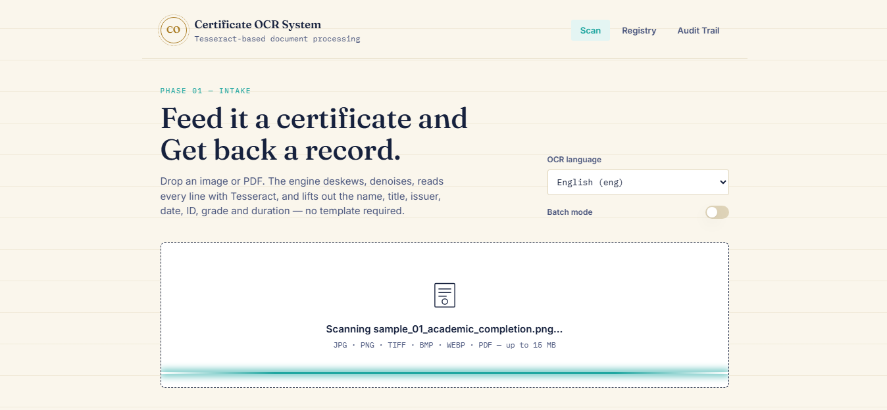
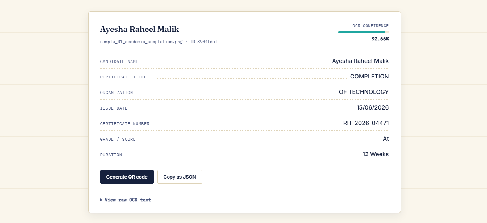
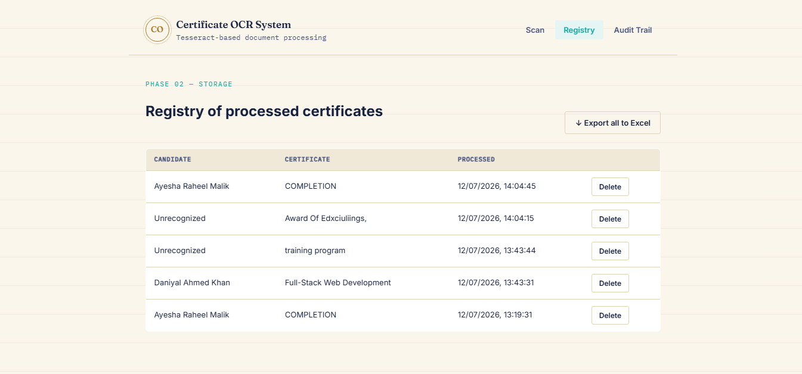
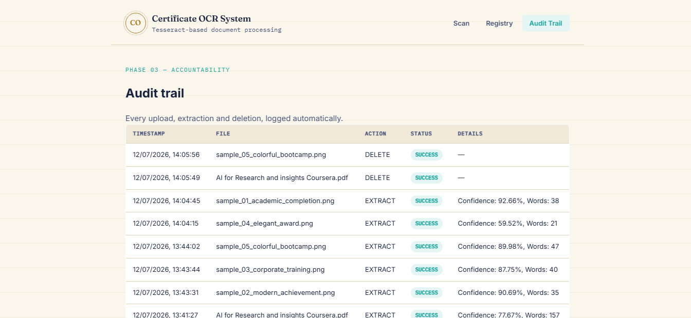

# Certificate-OCR-Based-Document-Processing-System

A full-stack web application that takes a photo, scan, or PDF of a certificate and
automatically extracts and structures the key information (candidate name, certificate
title, issuing organization, date, certificate number, grade, duration) using
Tesseract OCR, OpenCV preprocessing, and a rule-based extraction engine all served
through a FastAPI backend with an original, custom-designed frontend.

> **Application Screenshots.**
>
> 
> 
> 
> 

---

## Table of Contents

1. [Features](#features)
2. [Bonus Features](#bonus-features)
3. [Tech Stack](#tech-stack)
4. [Project Structure](#project-structure)
5. [Installation &amp; Setup](#installation--setup)
6. [Running the Application](#running-the-application)
7. [Usage Guide](#usage-guide)
8. [API Documentation](#api-documentation)
9. [Sample Certificates](#sample-certificates)
10. [How the Pipeline Works](#how-the-pipeline-works)
11. [Testing](#testing)
12. [Troubleshooting](#troubleshooting)
13. [Evaluation Criteria Mapping](#evaluation-criteria-mapping)
14. [Author Notes](#author-notes)

---

## Features

- **Drag-and-drop upload** for images (JPG, PNG, TIFF, BMP, WEBP) and multi-page PDFs
- **Image preprocessing pipeline**: grayscale conversion, CLAHE contrast enhancement,
  denoising, adaptive thresholding, and automatic deskewing before OCR runs
- **Tesseract OCR integration** with word-level confidence scoring
- **Intelligent field extraction**: candidate name, certificate title, organization,
  issue date, certificate number, grade/score, and duration — using a layered
  regex + heuristic engine that isn't tied to one fixed certificate template
- **Structured JSON API responses** and a clean "registry ledger" results view
- **SQLite persistent storage** of every processed certificate
- **Registry view** to browse, review, and delete previously processed certificates
- **Original custom-built UI** — no template kit — themed around a physical document
  registry with a scanning-beam animation as its signature interaction

## Bonus Features

Five bonus features beyond the core requirements were implemented:

| # | Feature                                                                                                                                                | Where                                                                       |
| - | ------------------------------------------------------------------------------------------------------------------------------------------------------ | --------------------------------------------------------------------------- |
| 1 | **Batch Processing** — upload and process multiple certificates in one request                                                                  | `POST /batch-extract`, "Batch mode" toggle in the UI                      |
| 2 | **Excel Export** — download every processed certificate as a formatted `.xlsx`                                                                | `GET /export/excel`, "Export all to Excel" button in Registry view        |
| 3 | **QR Code Generation** — generate a scannable QR code encoding a certificate's extracted data                                                   | `GET /certificates/{id}/qrcode`, "Generate QR code" button on each result |
| 4 | **Audit Trail** — every upload, extraction, and deletion is logged with a timestamp and status                                                  | `GET /audit-log`, dedicated "Audit Trail" tab in the UI                   |
| 5 | **Multi-language OCR Support** — switch the Tesseract language (English, Urdu, Arabic, French, Spanish, German, Chinese, Hindi) before scanning | `GET /languages`, language selector in the Scan view                      |

## Tech Stack

| Component        | Technology                                                                     |
| ---------------- | ------------------------------------------------------------------------------ |
| Language         | Python 3.11+                                                                   |
| Web Framework    | FastAPI + Uvicorn                                                              |
| OCR Engine       | Tesseract OCR 5.x (via`pytesseract`)                                         |
| Image Processing | OpenCV, Pillow, NumPy                                                          |
| PDF Processing   | `pdf2image` + Poppler                                                        |
| Database         | SQLite via SQLAlchemy                                                          |
| Bonus tooling    | `qrcode`, `openpyxl`                                                       |
| Frontend         | Hand-written HTML5 / CSS3 / vanilla JavaScript (no framework, no template kit) |
| Testing          | `pytest`, `httpx` (FastAPI `TestClient`)                                 |

## Project Structure

```
certificate-ocr-system/
├── app/
│   ├── api/
│   │   └── routes.py            # all REST endpoints (core + bonus)
│   ├── core/
│   │   ├── ocr_engine.py        # Tesseract wrapper, multi-language, multi-page
│   │   ├── preprocessor.py      # OpenCV image enhancement pipeline
│   │   └── extractor.py         # regex/heuristic field extraction
│   ├── models/
│   │   └── database.py          # SQLAlchemy models (Certificate, AuditLog)
│   └── utils/
│       ├── file_handler.py      # save uploads, PDF → image conversion
│       ├── validators.py        # file type / size validation
│       ├── qr_generator.py      # bonus: QR code generation
│       └── excel_export.py      # bonus: Excel export
├── static/
│   ├── css/style.css            # custom design system
│   ├── js/app.js                # frontend application logic
│   └── images/                  # QR codes land in images/qrcodes/, screenshots go in images/screenshots/
├── templates/
│   ├── index.html               # main single-page application
│   └── results.html             # standalone results template (reference)
├── tests/
│   ├── test_ocr.py              # unit tests: preprocessing, OCR, extraction
│   ├── test_api.py              # integration tests: all API endpoints
│   └── sample_certificates/     # 5 generated sample certificates + generator script
├── uploads/                     # temporary storage for uploaded files (gitignored)
├── exports/                     # generated Excel exports land here (gitignored)
├── main.py                      # application entry point
├── requirements.txt
├── .gitignore
└── README.md
```

## Installation & Setup

### 1. Prerequisites

- **Python 3.11+**
- **Tesseract OCR 5.0+**
- **Poppler** (required by `pdf2image` for PDF support)
- **Git**

### 2. Install Tesseract OCR

<details>
<summary><strong>Windows</strong></summary>

1. Download the installer from the [UB-Mannheim Tesseract build](https://github.com/UB-Mannheim/tesseract/wiki)
2. Run the installer and note the install path (usually `C:\Program Files\Tesseract-OCR`)
3. Add that folder to your system `PATH`
4. If Python still can't find it, set the path explicitly at the top of
   `app/core/ocr_engine.py`:
   ```python
   pytesseract.pytesseract.tesseract_cmd = r"C:\Program Files\Tesseract-OCR\tesseract.exe"
   ```

</details>

<details>
<summary><strong>macOS</strong></summary>

```bash
brew install tesseract
brew install poppler
```

</details>

<details>
<summary><strong>Linux (Debian/Ubuntu)</strong></summary>

```bash
sudo apt-get update
sudo apt-get install tesseract-ocr
sudo apt-get install poppler-utils
# Optional extra languages, e.g. Urdu:
sudo apt-get install tesseract-ocr-urd
```

</details>

Verify the install:

```bash
tesseract --version
```

### 3. Install Poppler (Windows only — macOS/Linux covered above)

Download from [Poppler for Windows](https://github.com/oschwartz10612/poppler-windows/releases)
and add the `bin/` folder to your system `PATH`.

### 4. Clone the repository

```bash
git clone <your-repository-url>
cd certificate-ocr-system
```

### 5. Create a virtual environment

```bash
python -m venv venv

# Activate it
venv\Scripts\activate        # Windows
source venv/bin/activate     # Linux/macOS
```

### 6. Install Python dependencies

```bash
python -m pip install --upgrade pip
pip install -r requirements.txt
```

## Running the Application

```bash
uvicorn main:app --reload
```

Then open **http://localhost:8000** in your browser. Interactive API docs
(Swagger UI) are automatically available at **http://localhost:8000/docs**.

## Usage Guide

1. Open the app and stay on the **Scan** tab.
2. (Optional) Choose an OCR language other than English from the dropdown.
3. (Optional) Toggle **Batch mode** on if you want to select several certificates at once.
4. Drag a certificate image or PDF onto the scanner, or click it to browse.
5. Watch the scanning-beam animation while Tesseract processes the document.
6. Review the extracted fields in the results ledger any field that couldn't be
   confidently detected is shown as *"Not detected"* rather than a guess.
7. Click **Generate QR code** to get a scannable code encoding the result, or
   **Copy as JSON** to grab the raw structured data.
8. Switch to the **Registry** tab to see every certificate processed so far, delete
   old entries, or **Export all to Excel**.
9. Switch to the **Audit Trail** tab to see a full log of every upload/extract/delete action.

## API Documentation

### Core Endpoints

| Method     | Endpoint              | Description                          |
| ---------- | --------------------- | ------------------------------------ |
| `GET`    | `/`                 | Serves the web application           |
| `GET`    | `/health`           | Health check                         |
| `POST`   | `/upload`           | Upload a file without processing it  |
| `POST`   | `/extract?lang=eng` | Upload + full OCR + field extraction |
| `GET`    | `/results/{id}`     | Fetch a previously extracted result  |
| `GET`    | `/documents`        | List all processed certificates      |
| `DELETE` | `/documents/{id}`   | Delete a stored result               |

### Bonus Endpoints

| Method   | Endpoint                      | Description                               |
| -------- | ----------------------------- | ----------------------------------------- |
| `POST` | `/batch-extract?lang=eng`   | Process multiple certificates in one call |
| `GET`  | `/export/excel`             | Download all results as a`.xlsx` file   |
| `GET`  | `/certificates/{id}/qrcode` | Get a QR code encoding a result           |
| `GET`  | `/audit-log`                | View the full processing audit trail      |
| `GET`  | `/languages`                | List supported OCR languages              |

### Example API Usage

```python
import requests

files = {"file": open("certificate.pdf", "rb")}
response = requests.post("http://localhost:8000/extract", files=files)

if response.status_code == 200:
    data = response.json()
    print(f"Name: {data['candidate_name']}")
    print(f"Certificate: {data['certificate_title']}")
```

## Sample Certificates

Five sample certificates are included in `tests/sample_certificates/`, each with a
distinct visual design so the extraction engine is demonstrated against varied
layouts rather than one fixed template:

| File                                  | Design                                                              | Theme                                     |
| ------------------------------------- | ------------------------------------------------------------------- | ----------------------------------------- |
| `sample_01_academic_completion.png` | Classic academic — cream paper, navy border, gold seal, serif type | University-style completion certificate   |
| `sample_02_modern_achievement.png`  | Modern minimalist — white background, teal accent bar, sans-serif  | Bootcamp achievement certificate          |
| `sample_03_corporate_training.png`  | Corporate — deep blue header banner, structured info grid          | Corporate training certificate            |
| `sample_04_elegant_award.png`       | Elegant/formal — dark background, gold ink, ornamental border      | Design institute award                    |
| `sample_05_colorful_bootcamp.png`   | Colorful/youthful — gradient banner, bright accents                | Youth hackathon participation certificate |

They were generated programmatically (`tests/sample_certificates/generate_samples.py`,
using Pillow) so they are free to use, reuse, and regenerate for testing. Every field
the extraction engine targets (name, title, organization, date, ID, grade, duration)
is present on each certificate in a slightly different position and wording, which is
exactly what real Tesseract OCR + the regex extraction engine were tested against
while building this project — real extraction, not a hand-scripted demo.

## How the Pipeline Works

```
Upload → Validate → (PDF → image, if needed) → Preprocess → Tesseract OCR
        → Parse & Extract Fields → Store in SQLite → Return JSON to the UI
```

1. **Upload & Validation** — file type and size are checked (`app/utils/validators.py`)
2. **PDF Conversion** — multi-page PDFs are converted to one image per page via Poppler
   (`app/utils/file_handler.py`)
3. **Preprocessing** — each image is upscaled if small, converted to grayscale,
   contrast-enhanced (CLAHE), denoised, adaptively thresholded, and deskewed
   (`app/core/preprocessor.py`)
4. **OCR** — Tesseract runs with `--oem 3 --psm 6`, tuned for a single block of
   certificate text, returning both plain text and per-word confidence scores
   (`app/core/ocr_engine.py`)
5. **Extraction** — a layered regex + heuristic engine looks for labeled fields
   ("Name:", "Awarded to", "Issued by"...) first, then falls back to structural
   heuristics (e.g. a short all-caps line near the top is likely the certificate
   title) (`app/core/extractor.py`)
6. **Storage** — the structured result is saved to SQLite, and every step is logged
   to the audit trail

## Testing

```bash
python -m pytest tests/ -v
```

- `tests/test_ocr.py` — unit tests for preprocessing, OCR, and field extraction
  logic (works fully offline once Tesseract is installed)
- `tests/test_api.py` — integration tests for every REST endpoint using FastAPI's
  `TestClient`

## Troubleshooting

| Issue                          | Solution                                                                                                                                            |
| ------------------------------ | --------------------------------------------------------------------------------------------------------------------------------------------------- |
| `TesseractNotFoundError`     | Verify Tesseract is installed and on your system`PATH`, or set `pytesseract.pytesseract.tesseract_cmd` explicitly in `app/core/ocr_engine.py` |
| PDF conversion fails           | Install Poppler and make sure it's on your system`PATH`                                                                                           |
| Poor OCR accuracy              | Make sure the source image is reasonably well-lit and in focus — the preprocessing pipeline helps a lot but can't fix an unreadable original       |
| `ModuleNotFoundError`        | Make sure your virtual environment is activated and run`pip install -r requirements.txt` again                                                    |
| Memory errors on large batches | Process fewer files per batch, or reduce image resolution before upload                                                                             |

## Evaluation Criteria Mapping

| Criteria       | Where it's addressed                                                                                       |
| -------------- | ---------------------------------------------------------------------------------------------------------- |
| Functionality  | Full upload → OCR → extraction → storage pipeline, all working end-to-end                               |
| Code Quality   | Modular`app/` package, docstrings throughout, type-safe dataclasses, PEP 8                               |
| UI/UX Design   | Custom-designed frontend (not a template), drag-and-drop, live feedback, responsive                        |
| Error Handling | File validation,`HTTPException` responses, try/except around the OCR pipeline, audit logging of failures |
| Bonus Features | 5 implemented: batch processing, Excel export, QR codes, audit trail, multi-language OCR                   |


## Author

Name : Hafiz Muhammad Faizan

Role : AI/ML Engineer

Company : Teerop Pvt. Limited

Website : www.hafizmfaizan.site
